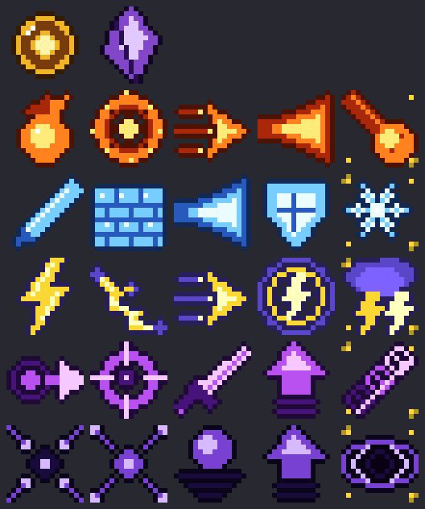

# Пробуждение — аддон для Minecraft Bedrock (PE)

Аналог Java-мода **The Awakening** для Minecraft Bedrock / Pocket Edition **1.21.90+**
(проверялся под 1.21.94). Управление адаптировано для телефона.



## Установка на телефон

1. Скачай файл [`dist/Awakening.mcaddon`](dist/Awakening.mcaddon) (кнопка «Download raw file»).
2. Открой его через Minecraft (из «Загрузок» или файлового менеджера). Игра сама импортирует оба пака.
3. В настройках мира включи:
   - **Наборы параметров поведения → Пробуждение (поведение)**
   - **Наборы ресурсов → Пробуждение (ресурсы)**
   - **Эксперименты → Бета-API** (рекомендуется; сам аддон использует стабильный Script API 2.0.0)

## Как играть

- При входе в мир ты получаешь **Сферу Пробуждения**. Нажми её, чтобы открыть меню.
- **Пробуждение:** получи урон, когда у тебя останется 3 сердца или меньше. Шанс пробуждения 30%,
  и с каждой неудачей он растёт: 55% → 80% → 100%. Сила выбирается случайно.
- **Способности** — отдельные предметы. Положи их в хотбар, выбери и нажми «Использовать».
- **Присядь и нажми** любой предмет силы, чтобы применить **ульту**.
- Перезарядка видна на иконке предмета и в строке над хотбаром.
- **Прокачка:** опыт силы даётся за убийства способностями, за каждый уровень — очко навыка.
  Очки тратятся на ранги способностей: +15% урона и −8% перезарядки за ранг, максимум ранг 5.
- Способности открываются на уровнях 1, 1, 3, 5 и 8 (ульта).
- **Задания** находятся в меню Сферы и дают опыт, очки навыков и алмазы.
- **Осколок Забвения** сбрасывает силу, после чего можно пробудиться заново с другой силой.

### Рецепты

| Предмет | Рецепт |
|---|---|
| Сфера Пробуждения | 4 осколка аметиста крестом вокруг эндер-жемчуга |
| Осколок Забвения | алмазы по углам, аметист по сторонам, око Края в центре |

## Силы

| Сила | Способности | Пассивка |
|---|---|---|
| 🔥 Пирокинетик | Огненный шар, Огненная волна, Огненный рывок, Огнемёт, **Метеор** | иммунитет к огню |
| ❄ Криокинетик | Ледяной осколок, Ледяная стена, Ледяное дыхание, Ледяная броня, **Абсолютный ноль** | вода под ногами замерзает, иммунитет к замедлению |
| ⚡ Повелитель бурь | Удар молнии, Цепная молния, Грозовой рывок, Грозовая аура, **Буря** | иммунитет к молниям |
| 🌀 Телепортер | Блинк, Метка, Удар в спину, Изгнание, **Шквал телепортов** | нет урона от падения |
| 🌑 Гравитон | Притяжение, Отталкивание, Невесомость, Антигравитация, **Сингулярность** | урон от падения снижен вдвое |

## Команды (нужны читы или права оператора)

```
/scriptevent aw:admin            — админ-меню: выдать силу, уровни, очки, сбросить прогресс
/scriptevent aw:power pyro       — дать себе силу (pyro, cryo, storm, tele, grav)
/scriptevent aw:reset            — сбросить свою силу
```

После `aw:admin` админ-меню также открывается приседанием с Сферой в руке.

## Для разработчика

- `tools/defs.py` — названия, описания и перезарядки способностей (единый источник).
- `tools/generate.py` — генерирует предметы, иконки, переводы и `scripts/defs.js`.
- `tools/build.sh` — генерирует ресурсы и собирает `dist/Awakening.mcaddon`.
- Логика способностей находится в `AwakeningBP/scripts/abilities.js`, меню — в `ui.js`,
  события и пробуждение — в `main.js`.
