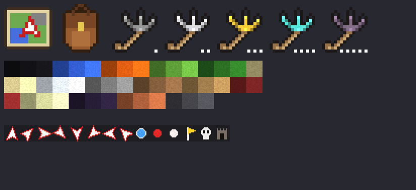
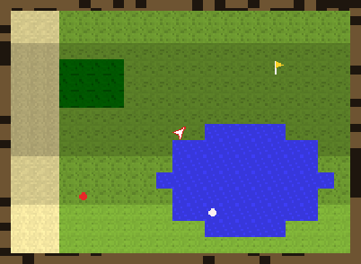

# Приключения — модпак для Minecraft PE

Работает на телефоне, Minecraft Bedrock 1.21.90+ (проверялось по API для 1.21.94).
Установка: открыть `dist/Adventure.mcaddon`, включить оба пака в мире. Можно вместе с «Пробуждением».



## Навигатор (миникарта)



Выдаётся при первом входе. Крафт: компас + 2 бумаги. Нажми, чтобы открыть окно с картой:

- карта вокруг тебя, север сверху, стрелка показывает, куда ты смотришь;
- **Приблизить / Отдалить** — масштаб 1:1, 1:2, 1:4, 1:8, 1:16;
- **Поставить вейпоинт** — сохраняет точку с названием;
- **Список вейпоинтов** (по 3 точки на страницу) — свои точки, найденные данжи и последние 5 точек смерти.
  Нажми на точку, чтобы **телепортироваться**, **переименовать** или **удалить** её;
- **Вид** — вид окна (картинка в рамке или простой символьный), вид карты (авто / поверхность / пещеры), размер карты, показ игроков, мобов
  (красные — враги, белые — мирные) и вейпоинтов.

## Крюк-кошка
Крафт в любом порядке, можно прямо в инвентаре: **палка + нитка + камень** (булыжник, камень, глубинный булыжник или чернокамень).
Рецепт появляется в книге рецептов, когда в инвентаре есть нитка.
Прочности нет. Нажми, чтобы бросить крюк:
- зацепился за блок — подтягивает тебя к нему (на уступ забрасывает сверху);
- попал в моба — подтягивает моба к тебе;
- нажми ещё раз или присядь — отпустить; после полёта урона от падения нет.

| Уровень | Улучшение (крюк + …) | Дальность | Скорость |
|---|---|---|---|
| I | палка + нитка + камень | 20 | 0.9 |
| II | 3 железных слитка | 30 | 1.15 |
| III | 3 золотых слитка | 40 | 1.4 |
| IV | 2 алмаза | 52 | 1.7 |
| V | 1 незеритовый слиток | 64 | 2.0 |

## Рюкзак
Крафт на верстаке: сверху «кожа, нитка, кожа», в середине «кожа, сундук, кожа», снизу три кожи (7 кожи, 1 нитка, 1 сундук).
Рецепт появляется в книге рецептов, когда в инвентаре есть сундук. На 27 слотов.
Нажми рюкзак — перед тобой появится бочка с вещами рюкзака, нажми на неё, чтобы открыть.
Нажми рюкзак ещё раз (или отойди на 7 блоков) — бочка сложится, вещи останутся в рюкзаке.
Вещи привязаны к конкретному рюкзаку и не теряются. Открытую бочку нельзя сломать.

## Данжи
Появляются под землёй в новых местах мира (примерно в половине участков 176×176 блоков).
Вход — каменная арка с лестницей вниз. При первом входе данж отмечается в навигаторе.
Каждый данж — 9 залов: залы с мобами, элитные стражи, ловушки, сундуки и зал босса.
После победы над боссом появляются два сундука с наградой.

| Данж | Глубина | Мобы | Ловушка | Босс |
|---|---|---|---|---|
| Крипта Забытых | ~15 | зомби, скелеты, кадавры | стрелы из стен | Хранитель Крипты (призывает скелетов) |
| Ледяной Склеп | ~15 | зимогоры | ямы с рыхлым снегом | Ледяной Король (замедляет) |
| Пылающая Кузня | ~26 | скелеты-иссушители, ифриты, магмовые кубы | огненные струи | Мастер Кузни (поджигает) |

## Команды (нужны читы)
```
/scriptevent adv:dungeon crypt   — построить данж перед собой (crypt, frost, forge)
/scriptevent adv:kit             — выдать навигатор, рюкзак и крюк V
```
